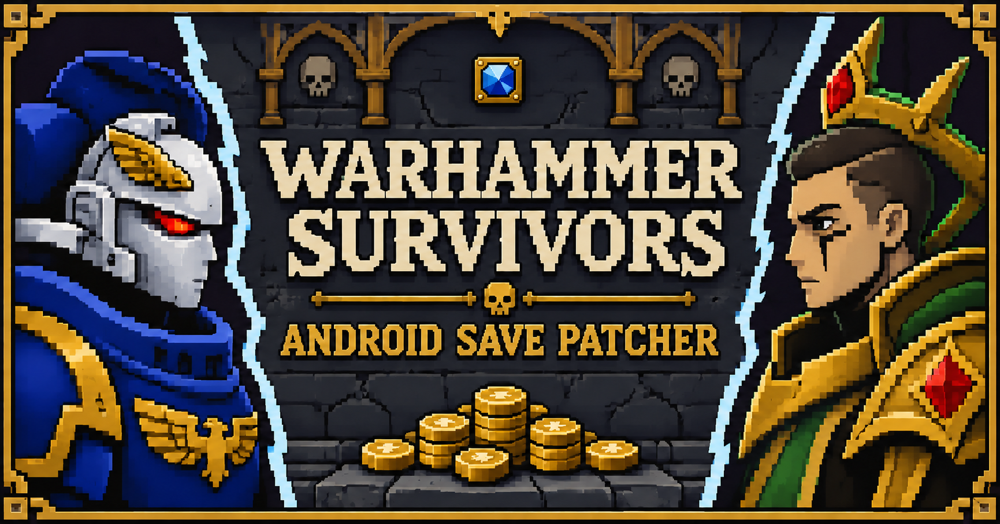

# Warhammer Survivors Android Save Patcher

Edit 40K and Age of Sigmar coins in a **copy** of a local save. The pixel web interface and Node script share the same validation and checksum implementation. Files stay on your device; there is no upload, account, or backend.

**[Open the editor](https://vdustr.github.io/game-data-patch-android-warhammer-survivors/)** · **[Download standalone tools](https://github.com/VdustR/game-data-patch-android-warhammer-survivors/releases/latest)** · **[Agent usage skill](skills/warhammer-save-patch/SKILL.md)**



## Verified game

| Item                         | Device-tested value                    |
| ---------------------------- | -------------------------------------- |
| Game version                 | **2.1.4**                              |
| APK versionCode              | **178089**                             |
| Android package              | `com.AurochDigital.WarhammerSurvivors` |
| OS / test date               | Android 17 / 2026-11-10 (Asia/Taipei)  |
| Tested target in both worlds | **1,000,000** and **1,000,000,000**    |

The game loaded both billion balances and retained them in its next written save. Both main menus displayed **9,999,999** for the stored billion. Subsequent AoS upgrade purchases reduced the stored value correctly. Online cloud persistence and a later full restart after that test remain unverified. The save exposes its game version, **not** its APK versionCode; the table records the tested installation.

## Browser

1. Open the [website](https://vdustr.github.io/game-data-patch-android-warhammer-survivors/), or download `warhammer-save-patcher.html` from [Releases](https://github.com/VdustR/game-data-patch-android-warhammer-survivors/releases/latest) and open it directly in a current browser.
2. Select `SaveDataUnity.sav` or a backup. Review the detected version and current balances.
3. Enter one or both target amounts. A blank field preserves that world. The shortcuts set both worlds to 1 million or 1 billion.
4. Generate, then download the `.patched.sav` copy. A changed source or amount invalidates the previous download.

The standalone HTML includes its scripts, styling, font, and icon, and works without a server or network. The online site serves those assets from GitHub Pages; save processing makes no network requests. The page cannot directly overwrite the selected original. If the browser offers a Save As dialog, choose a separate destination and retain your backup.

## Node script

Use **Node 26 or newer**. Download `patch-save.mjs`; it is self-contained and needs no dependency installation. Keep the release license and notices with redistributed copies.

```sh
# Inspect only
node patch-save.mjs /path/to/SaveDataUnity.sav --inspect

# Create a separate copy with both balances at 1 billion
node patch-save.mjs /path/to/SaveDataUnity.sav --40k 1000000000 --aos 1000000000 -o /path/to/both-billion.sav

# Modify only AoS; preserve 40K
node patch-save.mjs /path/to/SaveDataUnity.sav --aos 1000000
```

Without `-o`, the output is beside the input with `.sav` replaced by `.patched.sav`. Existing destinations, including symbolic and hard links, are refused. The script never overwrites the original or an existing output. For a recognized but untested version, review the warning before adding `--allow-unverified-version`.

## Basic compatibility checks

- Nonempty UTF-8 JSON object, up to 5 MiB; no BOM, duplicate keys, excessive nesting, comments, or trailing commas.
- Root Android marker, nonempty game-version string, selected world, and nonnegative finite root/per-world coin numbers.
- Both `SilosSaveData.WH_40K.Coins` and `SilosSaveData.WH_AOS.Coins` must exist. Other game fields remain unrestricted; nested platform markers may be empty in genuine saves.
- The root checksum must match the known algorithm and original field formatting. A failed checksum blocks output.
- A version other than 2.1.4 warns and requires explicit acknowledgment. Basic recognition does not authenticate a save or guarantee game acceptance.
- Targets must be integers from 0 through 1 billion that `Math.fround` represents exactly. This is a tool limit, not a claimed game maximum.

## Checksum and preservation

Compute lowercase SHA-256 over the original UTF-8 text after globally replacing **every** match of `"checksum":"[a-z0-9]*"` with `"checksum":""`, including nested checksums. Store the digest in the root checksum.

The patcher changes only requested world coin tokens, the root `Coins` mirror when the selected world is requested, and the root checksum. It preserves other bytes, numeric representations, whitespace, unknown fields, progress, and nested checksum strings. Whole-file JSON reserialization is deliberately avoided.

## Applying a copy to Android

This tool does not automatically install files on a phone. The usual save directory is:

```text
/sdcard/Android/data/com.AurochDigital.WarhammerSurvivors/files/
```

1. Completely stop the game. Copy the **current** `SaveDataUnity.sav` and `SaveDataUnity.bak.sav` to a new local backup directory and verify those copies before changing anything.
2. Inspect and patch the backed-up main file. Keep the phone offline for the initial load test.
3. Copy the patch over the phone's original **`SaveDataUnity.sav`**. A file merely named `.patched.sav` beside it will not be loaded.
4. Start the game, check both balances and preserved progress, then inspect a copy of the game's next written main save.
5. If the test fails, stop the game and restore both originals; compare hashes and restore temporary network settings.

Use `adb -d` when a USB phone and emulator are both connected. Never install from a stale backup without first preserving current progress.

**Cloud conflicts:** identify the intended local save from observed content and its selection mark before confirming. Row order and timestamps alone are unreliable: the verified test showed equal timestamps, and selecting the wrong row restored old money. Local loading does not prove cloud persistence. Clearing Google Play cache was not needed for the verified checksum fix.

## Development

```sh
mise install
pnpm install --frozen-lockfile --ignore-scripts
pnpm exec husky
pnpm build
pnpm verify

# Source script, no separate CLI installation
pnpm patch /path/to/SaveDataUnity.sav --inspect

# Preview through an existing Portless installation
portless warhammer-save pnpm preview
```

`mise.toml` pins Node and pnpm; `packageManager` repeats the pnpm version for package-aware tools. Dependency lifecycle scripts are not needed. `pnpm exec husky` installs the project-local pre-commit hook; it runs lint-staged. `pnpm dev` starts Vite development mode. For browser tests, install Chromium with `pnpm exec playwright install chromium`; the config uses that bundled Chromium locally and in CI. Set `TEST_BROWSER_CHANNEL=chrome` to test an installed Chrome instead. Set `TEST_BASE_URL` to reuse an existing preview, otherwise Playwright owns a temporary preview server.

`pnpm build` creates `dist/` for Pages and `release/` for portable downloads. `pnpm verify` runs formatting, lint, strict TypeScript/Svelte checks, build, core/CLI tests, and browser tests. See [the stack decision](docs/stack.md), [verification limits](VERIFICATION.md), and [design contract](DESIGN.md).

## CI and releases

CI validates PRs, `codex/**` working branches, and main. Successful main CI triggers Pages and the Changesets workflow. Add a note with `pnpm changeset` for user-visible changes; the workflow creates a draft version PR and dispatches its CI. After review and merge, the next successful main CI publishes versioned HTML, Node script, notices, and SHA-256 checksums. No npm publication is configured.

## License and artwork

Original code and documentation: **[MIT © 2026 VdustR](LICENSE)**. This is an unofficial fan tool. Warhammer trademarks and game artwork remain with their respective rights holders; the app icon and generated social preview are not relicensed under MIT. See [asset sources and generation prompts](docs/assets.md).

Private saves, copied game binaries, and device screenshots are excluded from this repository.
